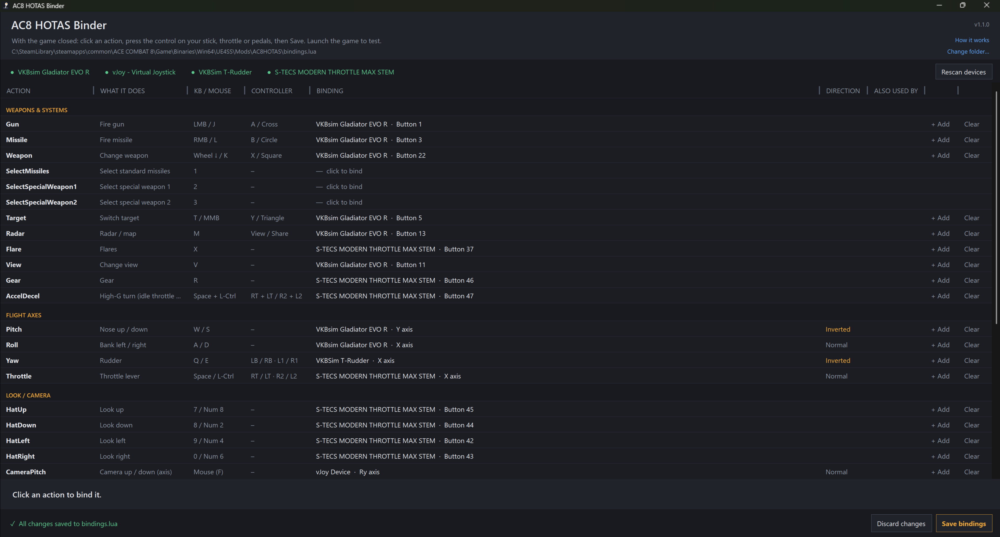
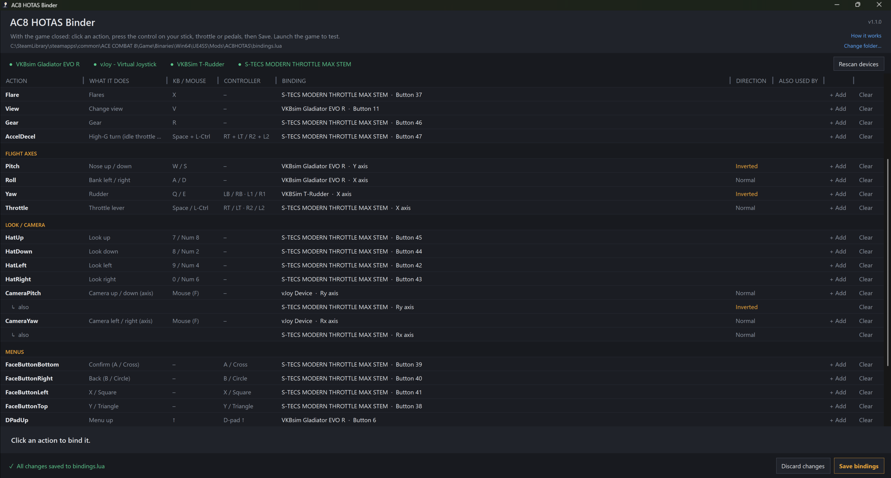
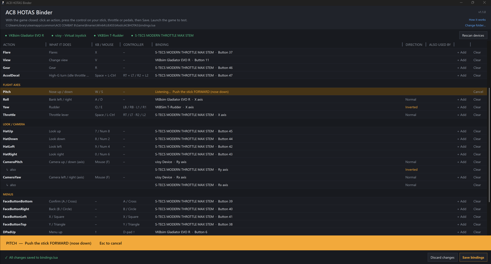
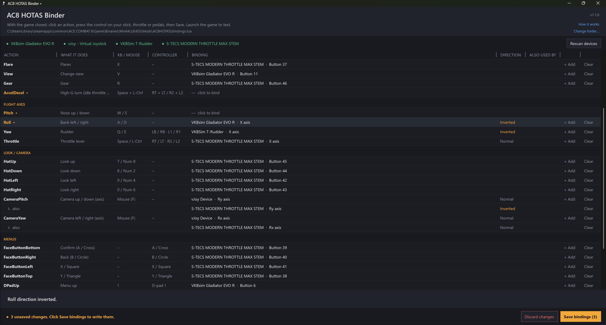
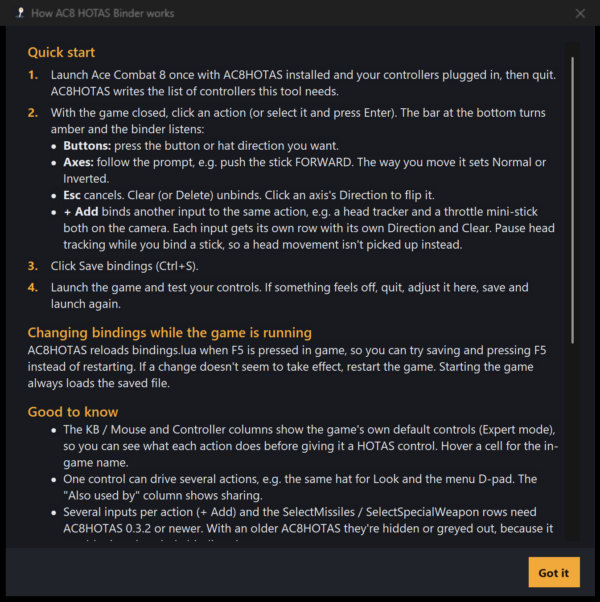

# AC8 HOTAS Binder

**Click an action. Press your HOTAS control. Save. Fly.**

A point-and-press binding editor for **[AC8 HOTAS Support](https://www.nexusmods.com/acecombat8wingsoftheve/mods/8)** by Drumsmasher17, the UE4SS mod that brings flight sticks, throttles and pedals to *Ace Combat 8: Wings of Theve*.

**[Download on Nexus Mods](https://www.nexusmods.com/acecombat8wingsoftheve/mods/53)** · [Releases](../../releases) · [License: MIT](LICENSE.txt)



## Built on the work of Drumsmasher17. Thank you!

This tool is only a front end. All the hard work of getting real sticks, throttles and pedals into Ace Combat 8 was done by **Drumsmasher17**:

- **[AC8 HOTAS Support (AC8HOTAS)](https://www.nexusmods.com/acecombat8wingsoftheve/mods/8)** ([GitHub](https://github.com/Drumsmasher17/AC8HOTAS)): the mod that maps multiple DirectInput devices straight onto the game's native flight-stick input. **Required.** The binder edits its `bindings.lua` and reads the device list it generates.
- **[AC8AnalogYaw](https://github.com/Drumsmasher17/AC8AnalogueYaw)** (bundled with AC8HOTAS): proportional yaw. It's what makes binding your rudder pedals actually worth it.
- Both run on **[UE4SS](https://github.com/UE4SS-RE/RE-UE4SS)** by the UE4SS-RE team.

If this tool helps you, please go and endorse [AC8 HOTAS Support](https://www.nexusmods.com/acecombat8wingsoftheve/mods/8) too. None of this works without it.

## What it does

AC8HOTAS is configured by editing `bindings.lua`: copying device GUIDs, button numbers and axis names by hand, then working out which way to invert each axis. AC8 HOTAS Binder replaces all of that with a window:

- **Click an action, press the control.** Buttons, hat directions and axes are detected live from your devices.
- **Guided axes.** "Push the stick FORWARD", "Throttle IDLE to FULL"... The way you move it sets Normal/Inverted automatically, and one click flips it later.
- **Several inputs per action** *(new in 1.1.0, needs AC8HOTAS 0.3.2+)*. Click **+ Add** to give an action another control: head tracking and a throttle mini-stick on the same camera axis, or two buttons for Switch target. Each input gets its own row with its own Direction and Clear.
- **Direct weapon select** *(new in 1.1.0, needs AC8HOTAS 0.3.2+)*. Bind SelectMissiles, SelectSpecialWeapon1 and SelectSpecialWeapon2 to pick a weapon directly instead of cycling.
- **See the game's own controls.** Each action shows the game's default keyboard/mouse and controller binding (Expert mode, from the game's Key Bindings and Button Mapping screens), so you know what an action does before you give it a HOTAS control. Hover a cell for the in-game name.
- **Not tied to one brand.** Reads any standard USB game controller (HID joystick/gamepad), including sticks, throttles, pedals, button boxes and virtual joysticks, with several devices at once. Developed and tested on VKB gear (Gladiator EVO R, S-TECS throttle, T-Rudder).
- **Safe edits.** Only the entries you change are rewritten. Your comments and AC8HOTAS's generated device list are untouched, and every save keeps a backup (`bindings.lua.binder.bak`).
- **Always know what's saved.** Unsaved changes are marked on each row and counted on the Save button, and Discard asks before throwing anything away. Columns resize live by dragging the grips in the header.
- **Simple workflow.** Bind with the game closed, save, then launch the game to test. For quick tweaks you can also try AC8HOTAS's in-game F5 reload, but restarting the game is the reliable way.
- **Plain-English help.** Shows which actions share a control, and explains when the game hasn't listed a device yet or AC8HOTAS can't use an input.
- **Read-only on your hardware.** It never changes controller settings, takes exclusive control, or sends input to the game.

| Several inputs per action | Binding an axis | Unsaved changes | Built-in help |
|---|---|---|---|
|  |  |  |  |

## Requirements

- [AC8 HOTAS Support](https://www.nexusmods.com/acecombat8wingsoftheve/mods/8) 0.2.0 or newer (and therefore UE4SS), installed and launched once with your controllers plugged in. Several inputs per action and direct weapon select need **0.3.2 or newer**. With an older version the binder hides them, because that version would reject the whole `bindings.lua`.
- Windows 10 or 11 (uses .NET Framework 4, which comes with Windows; nothing to install).

## Installation

1. Install AC8 HOTAS Support, launch the game once with your controllers connected, then quit. It writes the device list the binder needs.
2. Download the zip from [Nexus Mods](https://www.nexusmods.com/acecombat8wingsoftheve/mods/53) or [Releases](../../releases), and extract the **AC8-HOTAS-Binder** folder into your AC8HOTAS folder:
   ```
   ...\ACE COMBAT 8\Game\Binaries\Win64\UE4SS\Mods\AC8HOTAS\AC8-HOTAS-Binder\AC8-HOTAS-Binder.exe
   ```
   (Anywhere else works too; it asks for the AC8HOTAS folder once and remembers it.)
3. Run **AC8-HOTAS-Binder.exe**.

Manual install recommended: this is a standalone program, not a game mod, so there's nothing for a mod manager to deploy.
**Updating:** extract the new folder over the old one. Your `bindings.lua` is not touched by updating.

## How to use

1. With the game closed, run the binder and click an action (or select it and press Enter). The bar at the bottom turns amber.
2. Press the button or hat direction, or follow the axis prompt. Esc cancels.
3. Click **Clear** to unbind, or click an axis's **Direction** to flip it. Click **+ Add** to bind another control to the same action.
4. Click **Save bindings** (Ctrl+S). The button shows how many unsaved changes you have.
5. Launch the game and test. Tweak, save and relaunch as needed. (F5 in game may reload bindings without a restart, but isn't guaranteed.)

Full user documentation: [README.txt](README.txt), which is also included in the download.

## Head tracking (opentrack)

The camera axes accept any controller the game can see, including a virtual joystick. So [opentrack](https://github.com/opentrack/opentrack) can drive the camera from your head (webcam, phone app or IR clip) through a [vJoy](https://github.com/BrunnerInnovation/vJoy) virtual joystick. AC8's camera returns to centre when the stick does, so your head position sets the look angle. Only left/right and up/down exist; the game has no lean or zoom axis. Tested and working.

1. Install vJoy 2.2.x.
2. opentrack bundles an older `vJoyInterface.dll` (2.1.x) that claims the device but won't move the axes with the 2.2 driver. Close opentrack, then copy `C:\Program Files\vJoy\x64\vJoyInterface.dll` over the one in opentrack's `modules` folder (keep a backup).
3. In opentrack, set Output to *Joystick emulation (vjoystick)*. Head yaw goes to vJoy Rx and pitch to Ry. Click Start.
4. Launch the game once so vJoy is added to the game's device list, then quit.
5. In the binder, bind **Camera left / right** and **Camera up / down** by turning your head right and looking up when prompted. Save.

Each flight: start tracking in opentrack before the game, look straight ahead and press opentrack's centre key. If the camera sits stuck to one side, opentrack has stopped tracking (vJoy holds its last position until it resumes). Tune sensitivity with opentrack's yaw and pitch curves. The full walkthrough is in [README.txt](README.txt), under "Head tracking".

**Keep a stick on the camera too** (AC8HOTAS 0.3.2+): pause tracking in opentrack, click **+ Add** on each camera row and move your stick. How the game blends the two when both move at once hasn't been tested yet, so feedback is welcome. If opentrack stops tracking, vJoy holds its last position and the stick works against that offset.

## Good to know

- **SmartScreen:** the exe isn't code-signed, so Windows may say "Windows protected your PC". Click *More info → Run anyway*. The full C# source and a one-click `build.cmd` are included in the download and in this repo; it builds with the compiler that already ships with Windows.
- **New controller not showing as ready?** The game has to list it first. Launch the game once with it plugged in, quit, then click *Rescan devices*.
- **Camera axes need real axes.** A mini-stick in digital/button mode can be bound to the Look (Hat) actions instead.
- AC8HOTAS's own limits still apply: only the first hat, buttons 1-128, and two identical controllers can't be told apart.
- Axis directions follow the usual convention (stick forward = nose down, right = right, throttle forward = more). If one feels backwards in game, flip it, save and restart the game.
- "–" in the KB / Mouse or Controller column means the game's own menus don't list a default for that action.
- **Several inputs on one device:** inputs on different devices are the safe way to add more. Several on the *same* device can need more slots than the game has for that action; AC8HOTAS then rejects the whole file, and its newest `HOTAS-xxxxx.log` says why.
- A row reading *Edited by hand* is an entry in `bindings.lua` the binder doesn't recognise (for example defined twice). It's left alone, and the row says why. Lists written in AC8HOTAS's own format are fine.

### Files written

- `bindings.lua`: only the entries you changed (one input on one line; two or more in AC8HOTAS's list format)
- `bindings.lua.binder.bak`: the previous version, saved before every write
- `%APPDATA%\AC8-HOTAS-Binder\folder.txt`: remembers your AC8HOTAS folder

Uninstall by deleting the AC8-HOTAS-Binder folder.

## Building

The whole app is one C# 5 file, `src/Binder.cs`, built with the `csc.exe` that ships with Windows (.NET Framework 4.x). No SDK or Visual Studio needed.

**Windows:** run `build.cmd`.

**WSL:** `build.sh` calls the same Windows compiler through interop:

```bash
./build.sh            # build AC8-HOTAS-Binder.exe
./build.sh test       # build + read-only self-test against your AC8HOTAS folder
./build.sh install    # build + copy into <AC8HOTAS>/AC8-HOTAS-Binder/
./build.sh package    # build + dist/AC8-HOTAS-Binder-<version>.zip
```

Set `AC8HOTAS_DIR` if your AC8HOTAS folder isn't in the default Steam location.

The self-test (`AC8-HOTAS-Binder.exe --selftest "<AC8HOTAS folder>" "<report.txt>"`) parses your real `bindings.lua` and device list. It checks that edits round-trip and only touch the lines they should, and lists detected HID controllers. It never writes your bindings.

### How it works

- **Input:** reads controllers directly through the Windows HID API (`hid.dll`, read-only). It maps HID usages to the DirectInput names AC8HOTAS uses (`Button1..128`, `X/Y/Z/Rx/Ry/Rz/Slider1/Slider2`, `POV1_*`).
- **Devices:** matches controllers to the game's device GUIDs by product ID, using the catalog AC8HOTAS writes to `Scripts/devices.lua`.
- **Editing:** edits `bindings.lua` entry by entry instead of regenerating it, then re-parses the result before writing. One input stays on one line; two or more use AC8HOTAS's multi-line list format.
- **Compatibility:** checks the installed AC8HOTAS for each feature (`Scripts/mapper.lua` list support, `Scripts/weapon_select.lua`) rather than trusting a version number.

## Credits

- **PhantomLasagne** (Ph4ntomLasagne on Nexus · [GitHub](https://github.com/PhantomLasagne)): AC8 HOTAS Binder.
- **Drumsmasher17**: [AC8 HOTAS Support](https://www.nexusmods.com/acecombat8wingsoftheve/mods/8) ([GitHub](https://github.com/Drumsmasher17/AC8HOTAS)) and [AC8AnalogYaw](https://github.com/Drumsmasher17/AC8AnalogueYaw), the foundation this tool is built on. Released under CC0, which made a companion tool like this possible.
- **UE4SS-RE team**: [UE4SS](https://github.com/UE4SS-RE/RE-UE4SS).

This is an unofficial companion tool. It isn't made or endorsed by Drumsmasher17 or the UE4SS-RE team, so please report Binder issues here or on the [Nexus page](https://www.nexusmods.com/acecombat8wingsoftheve/mods/53) (Posts / Bugs tab), not on their pages.

## License

**[MIT License](LICENSE.txt)**, Copyright (c) 2026 PhantomLasagne. Fully open source: use it, modify it, fork it, bundle it with your own mods or re-upload it. The only condition is credit: keep the copyright notice and LICENSE.txt, and credit **PhantomLasagne** (GitHub) / **Ph4ntomLasagne** (Nexus Mods) as the original author. Developed with AI assistance; provided without warranty.
