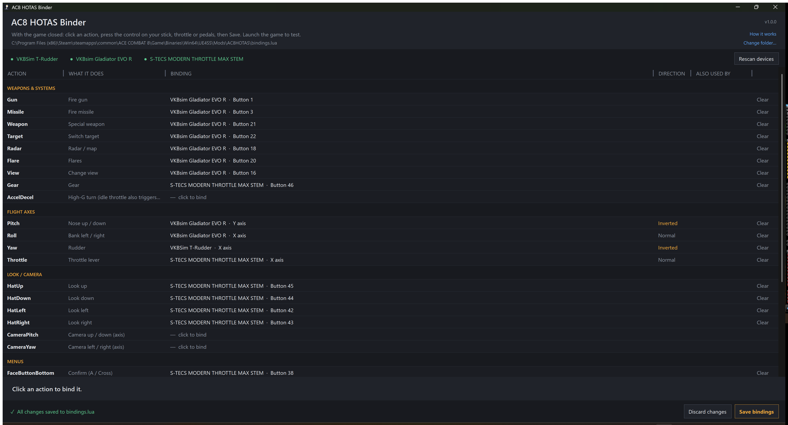
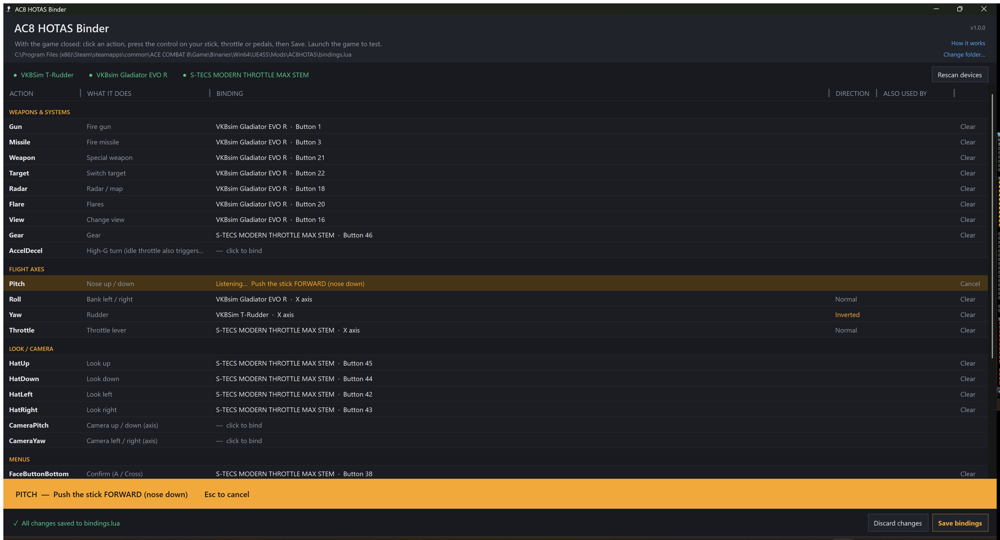
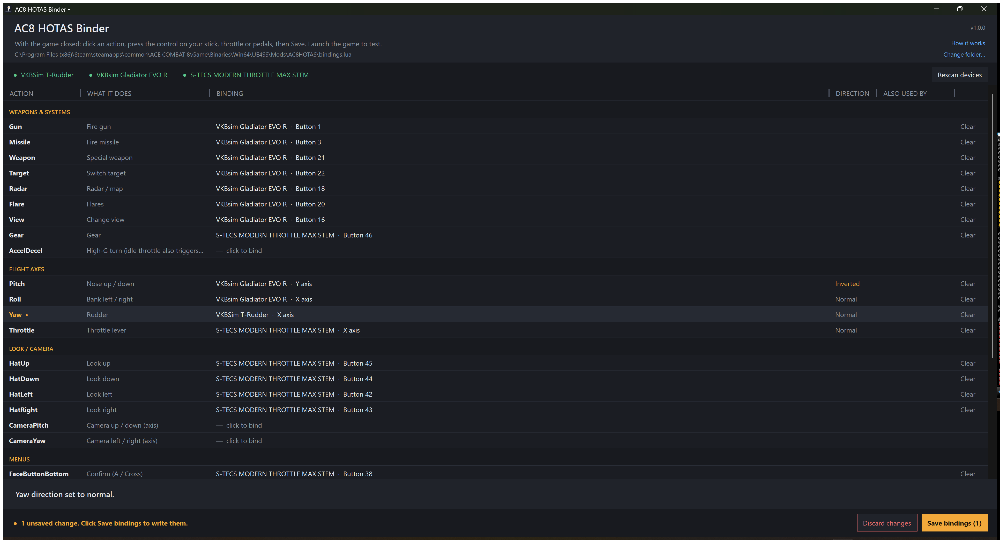
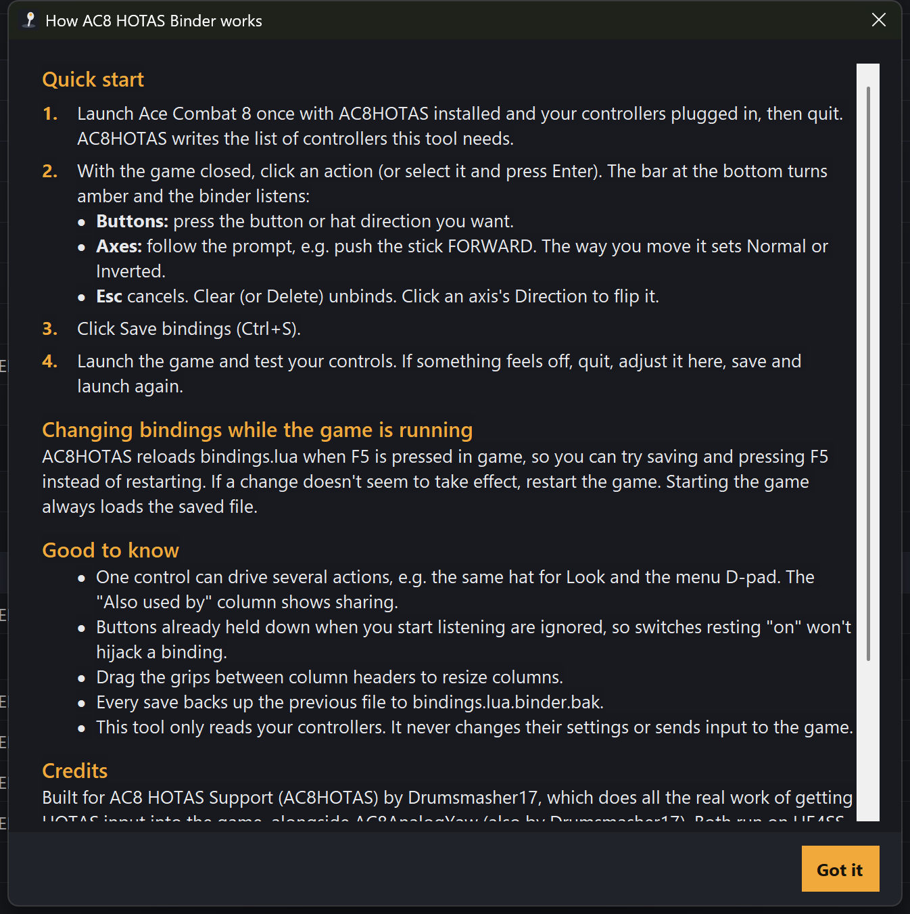

# AC8 HOTAS Binder

**Click an action. Press your HOTAS control. Save. Fly.**

A point-and-press binding editor for **[AC8 HOTAS Support](https://www.nexusmods.com/acecombat8wingsoftheve/mods/8)** by Drumsmasher17, the UE4SS mod that brings flight sticks, throttles and pedals to *Ace Combat 8: Wings of Theve*.

**[Download on Nexus Mods](https://www.nexusmods.com/acecombat8wingsoftheve/mods/53)** · [Releases](../../releases) · [License: MIT](LICENSE.txt)



## What it does

AC8HOTAS is configured by editing `bindings.lua` by hand: device GUIDs, button numbers, axis names and invert flags. This tool replaces that with a window:

- **Click an action, press the control.** Buttons, hat directions and axes are detected live.
- **Guided axes.** "Push the stick FORWARD", "Throttle IDLE to FULL"... The way you move it sets Normal/Inverted automatically.
- **Safe edits.** Only the lines you change are rewritten. Comments and AC8HOTAS's generated device list are untouched, and every save keeps a backup (`bindings.lua.binder.bak`).
- **Always know what's saved.** Unsaved changes are marked on each row and counted on the Save button.
- **Any HID game controller.** Several devices at once. Developed and tested on VKB gear (Gladiator EVO R, S-TECS throttle, T-Rudder).
- **Read-only on your hardware.** It never changes controller settings or sends input to the game.

| Binding an axis | Unsaved changes | Built-in help |
|---|---|---|
|  |  |  |

## Install and use

Requires [AC8 HOTAS Support](https://www.nexusmods.com/acecombat8wingsoftheve/mods/8) 0.2.0 and Windows 10/11. Nothing else is needed, since .NET Framework 4 ships with Windows.

1. Install AC8 HOTAS Support, launch the game once with your controllers plugged in, then quit.
2. Download the zip from [Nexus Mods](https://www.nexusmods.com/acecombat8wingsoftheve/mods/53) or [Releases](../../releases). Extract the `AC8-HOTAS-Binder` folder into `...\UE4SS\Mods\AC8HOTAS\`.
3. With the game closed, run `AC8-HOTAS-Binder.exe`, click actions, press controls, and click **Save bindings**.
4. Launch the game and test.

Full user documentation: [README.txt](README.txt), which is also included in the download.

## Building

The whole app is one C# 5 file, `src/Binder.cs`, built with the `csc.exe` that ships with Windows (.NET Framework 4.x). No SDK or Visual Studio needed.

**Windows:** run `build.cmd`.

**WSL:** `build.sh` calls the same Windows compiler through interop:

```bash
./build.sh            # build AC8-HOTAS-Binder.exe
./build.sh test       # build + read-only self-test against your AC8HOTAS folder
./build.sh install    # build + copy into <AC8HOTAS>/AC8-HOTAS-Binder/
./build.sh package    # build + dist/AC8-HOTAS-Binder-<version>.zip
```

Set `AC8HOTAS_DIR` if your AC8HOTAS folder isn't in the default Steam location.

The self-test (`AC8-HOTAS-Binder.exe --selftest "<AC8HOTAS folder>" "<report.txt>"`) parses your real `bindings.lua` and device list. It checks that edits round-trip and only touch the lines they should, and lists detected HID controllers. It never writes your bindings.

### How it works

- **Input:** reads controllers directly through the Windows HID API (`hid.dll`, read-only). It maps HID usages to the DirectInput names AC8HOTAS uses (`Button1..128`, `X/Y/Z/Rx/Ry/Rz/Slider1/Slider2`, `POV1_*`).
- **Devices:** matches controllers to the game's device GUIDs by product ID, using the catalog AC8HOTAS writes to `Scripts/devices.lua`.
- **Editing:** edits `bindings.lua` line by line instead of regenerating it, then re-parses the result before writing.

## Credits

- **[AC8 HOTAS Support (AC8HOTAS)](https://github.com/Drumsmasher17/AC8HOTAS)** and **[AC8AnalogYaw](https://github.com/Drumsmasher17/AC8AnalogueYaw)** by **Drumsmasher17**, the foundation this tool is built on. Thank you for the mods and for releasing them under CC0.
- **[UE4SS](https://github.com/UE4SS-RE/RE-UE4SS)** by the UE4SS-RE team.

This is an unofficial companion tool, not made or endorsed by the authors above. Please report Binder issues here or on the [Nexus page](https://www.nexusmods.com/acecombat8wingsoftheve/mods/53), not on theirs.

## License

[MIT](LICENSE.txt) © 2026 Ph4ntomLasagne. Use it, fork it or bundle it freely; just keep the copyright notice and credit **Ph4ntomLasagne** as the original author. Developed with AI assistance; provided without warranty.
